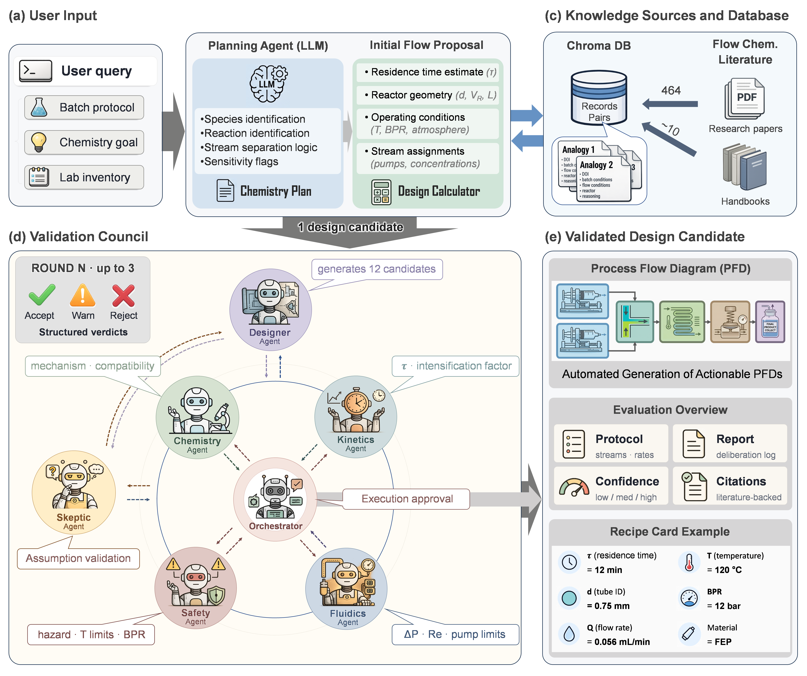
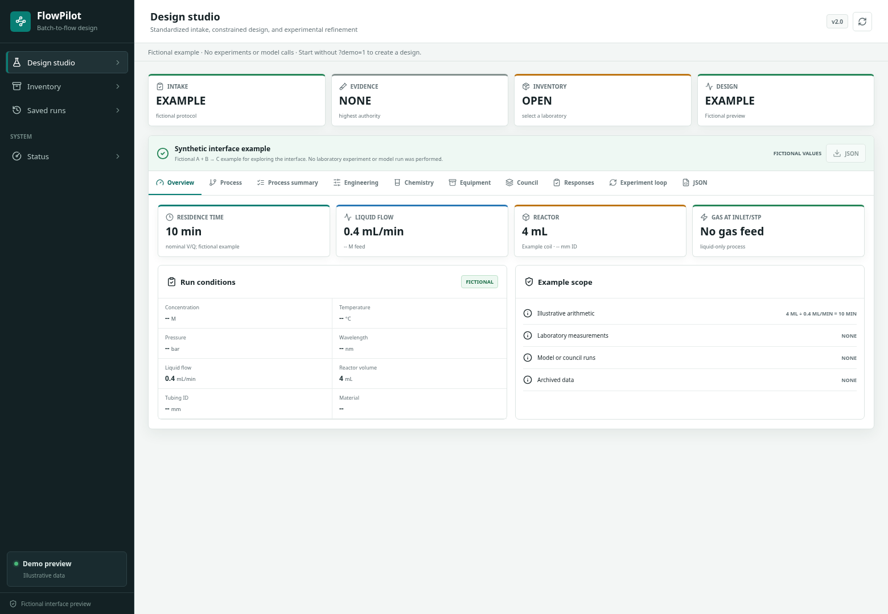

<div align="center">

# FlowPilot

**Multi-agent design of continuous-flow processes from batch chemistry.**

[Quickstart](#quickstart) · [Architecture](docs/architecture.md) · [Configuration](docs/configuration.md) · [Data setup](docs/data_setup.md) · [Citation](#citation)

</div>

FlowPilot brings chemical reasoning, literature evidence and engineering calculations into one batch-to-flow design workflow. Starting with a batch protocol, researcher priorities and laboratory inventory, it proposes candidate processes, reviews them through a specialist agent council, and produces a connected design that a researcher can inspect and refine.

The output is a **screening design**: feed compositions, stage conditions, equipment assignments and a process-flow diagram, accompanied by calculations, assumptions and the council's reasoning. Computational checks establish internal consistency; experimental performance remains to be measured.



*Architecture figure from the FlowPilot manuscript. Candidate counts, revision budgets and recipe values are schematic. The historical corpus count describes extracted records, not the bundled public data. [Open the full-resolution figure](docs/images/flowpilot-architecture.png) · [Provenance and interpretation](docs/images/README.md).*

## What FlowPilot does

- **Establishes a design brief.** Standardized intake separates protocol facts, objectives, measured evidence and laboratory constraints.
- **Grounds proposals in chemical knowledge.** Plan-aware retrieval connects chemistry to relevant flow precedents and engineering rules when those resources are configured.
- **Checks the engineering.** Deterministic calculations cover residence time, flow, geometry, pressure loss, heat and mass transfer, gas delivery and equipment limits.
- **Reviews alternatives.** Designer, chemistry, kinetics, fluidics, safety, skeptic and chief-engineer agents evaluate candidate processes and record their reasoning.
- **Keeps the result connected.** A canonical final design synchronizes numerical results, stream assignments, equipment, topology and exported artifacts.
- **Supports iteration.** The workspace includes inventory editing, saved runs and refinement using experimental observations.



*The current React workspace in illustrative demo mode. The displayed numbers are interface examples, not a computed research result. [Open the full-size screenshot](docs/images/flowpilot-workspace.png).*

## Quickstart

Use **Python 3.11+** and **Node.js 22.12+**. Install the Graphviz executable (`dot`) and Cairo native library for the complete diagram renderer.

```bash
git clone https://github.com/armtfgh/flowpilot.git
cd flowpilot
python -m venv .venv
source .venv/bin/activate
python -m pip install -e ".[web]"
npm --prefix flowpilot_webapp/frontend ci
npm --prefix flowpilot_webapp/frontend run build
flowpilot check
flowpilot serve --host 127.0.0.1 --port 8510
```

On Windows, activate the environment with `.\.venv\Scripts\Activate.ps1`.

Open **http://localhost:8510**. To explore the populated interface without a model call, open **http://localhost:8510/?demo=1**. The demo is illustrative interface data, not a newly computed or experimentally validated process.

For live designs, configure your model credentials and knowledge resources using the [configuration guide](docs/configuration.md) and [data setup guide](docs/data_setup.md). The research literature corpus, stored embeddings and handbook-derived rule collection are **not bundled** with this source release.

### Command line

```bash
# Check local configuration without calling model providers.
flowpilot check

# Index your own structured literature records; this calls configured models.
flowpilot index /path/to/records

# Generate a design after configuring providers and data.
flowpilot translate --file examples/batch_protocol.txt \
  --inventory examples/lab_inventory.json \
  --output result.json
```

The [example inputs](examples/README.md) illustrate the expected format and do not report experimental outcomes. Software tests use purpose-built inputs; historical benchmark campaigns, laboratory datasets and saved research designs are not included. Use `flowpilot --help` and each subcommand's `--help` for available options.

## Explore the project

| Resource | What you will find |
| --- | --- |
| [Architecture](docs/architecture.md) | Pipeline stages, council roles and the final-design contract |
| [Configuration](docs/configuration.md) | Providers, local models, runtime storage and optional interfaces |
| [Data setup](docs/data_setup.md) | Supplying literature records, rules and laboratory inventory |
| [Reproducibility](docs/reproducibility.md) | Scope of this release and distinctions from historical research campaigns |
| [Contributing](CONTRIBUTING.md) | Development setup, focused tests and contribution guidance |

The main implementation is in `flowpilot_translate/`; `flowpilot_webapp/` provides the React/FastAPI workspace. Supporting packages handle literature discovery (`flowpilot_scout`), extraction (`flowpilot_prism`), engineering knowledge (`flowpilot_fundamentals`), design utilities (`flowpilot_design`) and optimization (`flowpilot_optimize`). An optional Streamlit interface is retained in `app.py`.

## Citation

If you use FlowPilot in research, cite the accompanying manuscript:

> Amirreza Mottafegh, Mincheol Park, Jun-young Jo, Jin Suk Myung, Boyoung Y. Park and Gwang-Noh Ahn. **Agentic design of continuous flow processes with chemical knowledge and laboratory constraints.** Unpublished manuscript, 2026.

Amirreza Mottafegh and Mincheol Park contributed equally. Machine-readable metadata is provided in [CITATION.cff](CITATION.cff). No publication or data DOI has been assigned in this repository.

## License

A license has not yet been selected, and no open-source license is currently applied. See [licensing status](docs/licensing.md).
