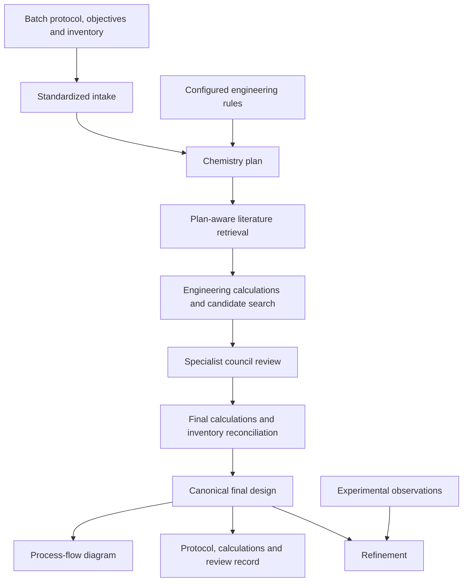

# Architecture

FlowPilot combines model-based interpretation with deterministic engineering checks. The web workspace, command line and optional Streamlit interface share the Python pipeline in `flowpilot_translate`.

## From protocol to proposal

Intake records the source protocol separately from researcher preferences and equipment constraints. Chemistry planning identifies the transformation, species, stage sequence, stream logic and sensitivities. Retrieval uses that plan to search configured literature records and select relevant analogies.

Engineering calculations and design-space search supply candidate operating conditions. They connect residence time, volume, flow, tubing geometry, pressure loss and transport estimates. The treatment of gas flows includes explicit reference conditions; multistage designs account for material added between reactors.

These calculations depend on the information and approximations available. They do not replace kinetic measurements or a complete process simulator.

## Council roles

| Role | Contribution |
| --- | --- |
| Designer | Proposes candidate combinations subject to constraints |
| Chemistry | Reviews mechanism, compatibility and process chemistry |
| Kinetics | Reviews residence-time assumptions and intensification claims |
| Fluidics | Reviews flow, pressure and transport considerations |
| Safety | Reviews hazards and operating limits |
| Skeptic | Challenges assumptions, arithmetic and the scope of evidence |
| Chief engineer | Integrates reviews, selects a candidate and records the decision |

Candidate budgets, models and revision settings are configurable. Counts in the manuscript overview are illustrative rather than fixed guarantees for every run.

## One final design

The selected proposal passes through final calculations, inventory reconciliation and topology construction. `result.final_design` is the canonical record used by result views. Stream flow rates, stage conditions and diagram labels must agree with that record.

The pipeline distinguishes a candidate that passes its computational checks from a diagnostic or blocked candidate. A completed model response alone is not sufficient to establish a usable design. A passing screening proposal still requires researcher review and experimental assessment.

## Code map

| Component | Main source |
| --- | --- |
| Pipeline orchestration | [`flowpilot_translate/main.py`](../flowpilot_translate/main.py) |
| Schemas and inventory | [`flowpilot_translate/schemas.py`](../flowpilot_translate/schemas.py) |
| Chemistry-aware retrieval | [`flowpilot_translate/retriever.py`](../flowpilot_translate/retriever.py) |
| Engineering calculations | [`flowpilot_translate/design_calculator.py`](../flowpilot_translate/design_calculator.py) |
| Council | [`flowpilot_translate/engine/council_v4/`](../flowpilot_translate/engine/council_v4/) |
| Final-design contract | [`flowpilot_translate/final_design_contract.py`](../flowpilot_translate/final_design_contract.py) |
| Web API and background jobs | [`flowpilot_webapp/backend/`](../flowpilot_webapp/backend/) |
| React workspace | [`flowpilot_webapp/frontend/src/`](../flowpilot_webapp/frontend/src/) |
